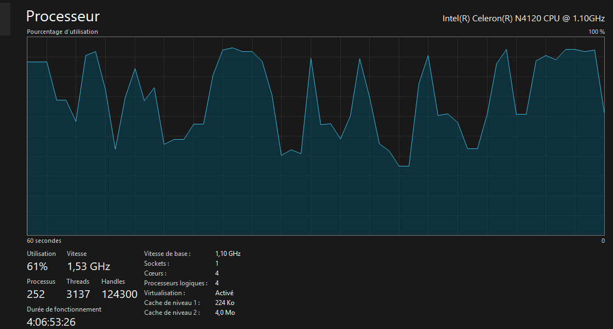
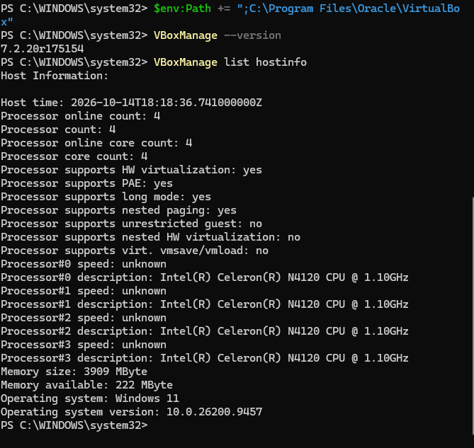
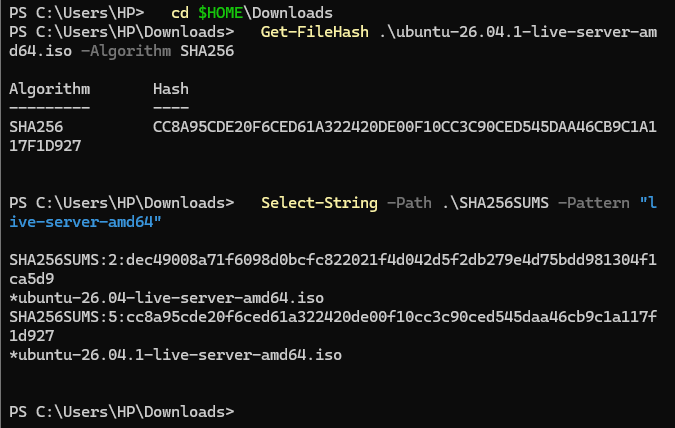
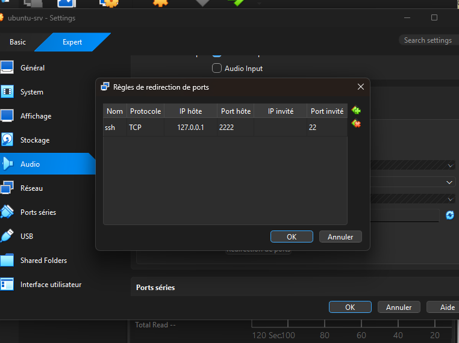
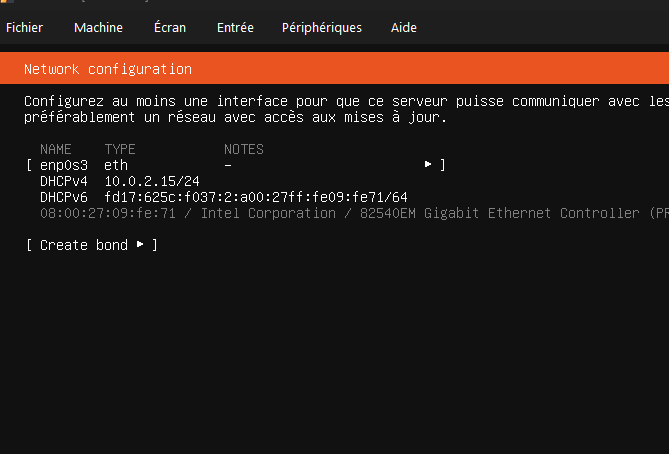
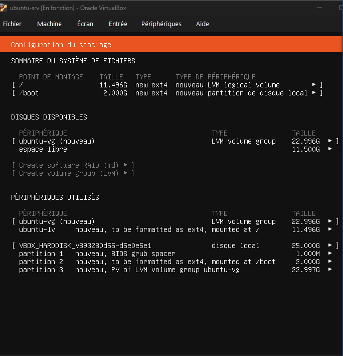
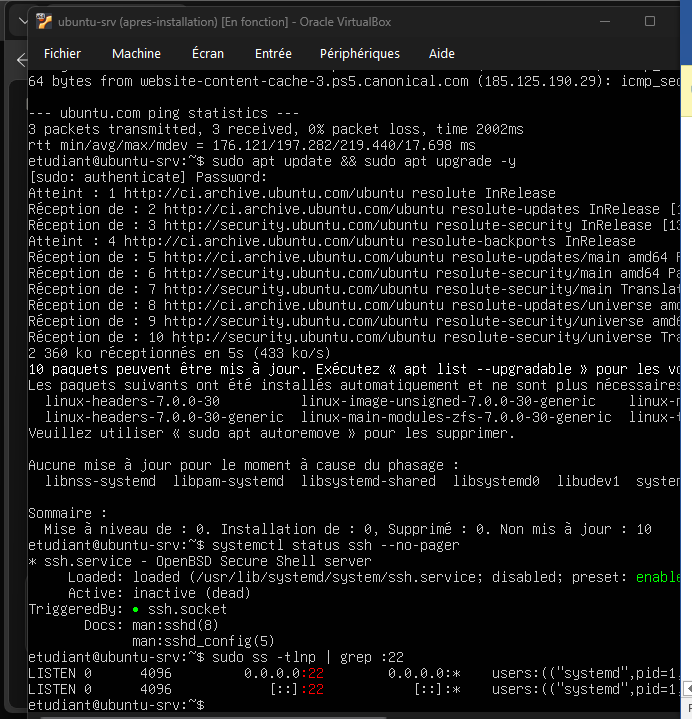

# TP1 de cloud : Installation de VirtualBox et création d'une VM Ubuntu

| | |
| --- | --- |
| **Cours** | Introduction au Cloud Computing |
| **Filière** | Licence 3 RIST / BDGL |
| **Établissement** | UFR Mathématiques & Informatique |
| **Enseignant** | BAKAYOKO Ibrahima |
| **Séance** | 1 : Découverte de la virtualisation |
| **Groupe** | POKOU - KOIKAN - N'DRI. Membres du groupe : POKOU EVA MARIA - KOIKAN ANGOLA CHRIST - N'DRI KOUASSI ELIOREPH |
| **Date** | Octobre 2026 |
| **Dépôt Git** | [https://github.com/evamariaan/groupe-pokou-koikan-n-dri](https://github.com/evamariaan/groupe-pokou-koikan-n-dri) |

## Objectif du TP

Dans ce TP, nous avons installé VirtualBox sur Windows 11, téléchargé et vérifié l'image ISO d'Ubuntu Server 26.04.1 LTS, créé la machine virtuelle `ubuntu-srv` en réseau NAT avec une redirection de port, installé Ubuntu Server, nous y sommes connectés en SSH depuis l'hôte, puis manipulé un instantané et un clone.

Notre PC est modeste (Celeron N4120, 4 cœurs, 3909 Mo de RAM) : nous avons donc réduit la VM à **1536 Mo de RAM et 1 processeur** au lieu de 2048 Mo et 2 processeurs dans l'énoncé. Les parties 1, 2 et 6 se font dans PowerShell sur l'hôte. La partie 5 se fait dans la VM, puis dans PowerShell pour SSH.

## Sommaire

1. Partie 1 : Préparer l'hôte et installer VirtualBox
2. Partie 2 : Télécharger et vérifier l'image ISO Ubuntu
3. Partie 3 : Créer et configurer la machine virtuelle
4. Partie 4 : Installer Ubuntu Server
5. Partie 5 : Premiers pas, réseau et accès SSH
6. Partie 6 : Instantané, clone et arrêt
7. Fichiers à joindre au dépôt
8. Difficultés rencontrées

## Partie 1 : Préparer l'hôte et installer VirtualBox

### Commandes lancées et sorties

Dans le Gestionnaire des tâches (Performance, Processeur), la ligne « Virtualisation » indique **Activé**.

[](images/p1-virtualisation.png)

Ensuite, dans PowerShell administrateur :

```powershell
bcdedit /enum | findstr hypervisorlaunchtype
```

Sortie : `hypervisorlaunchtype    Auto`

```powershell
systeminfo | findstr /C:"Hyper-V"
```

Sortie : `Configuration requise pour Hyper-V : Un hyperviseur a été détecté. Les fonctionnalités nécessaires à Hyper-V ne seront pas affichées.`

L'hyperviseur de Windows est donc actif sur notre PC. Cela peut ralentir VirtualBox (icône de tortue verte en bas de la fenêtre de la VM).

Après l'installation de VirtualBox (options par défaut), nous avons ajouté son dossier au PATH de la session et vérifié la version :

```powershell
$env:Path += ";C:\Program Files\Oracle\VirtualBox"
VBoxManage --version
```

Sortie : `7.2.20r175154`

```powershell
VBoxManage list hostinfo
```

[](images/p1-hostinfo.png)

Sortie (extrait) :

```
Processor online count: 4
Processor core count: 4
Processor supports HW virtualization: yes
Processor supports long mode: yes
Processor supports nested paging: yes
Processor#0 description: Intel(R) Celeron(R) N4120 CPU @ 1.10GHz
Memory size: 3909 MByte
Memory available: 482 MByte
Operating system: Windows 11
Operating system version: 10.0.26200.9457
```

Dans l'interface de VirtualBox, le dossier par défaut des machines (Fichier, Paramètres, Général) est `C:\Users\HP\VirtualBox VMs`.

### Réponses aux questions

**1. Hyperviseur de type 1 et de type 2**

Un hyperviseur est un logiciel qui permet de créer et de gérer des machines virtuelles en partageant les ressources d'un même ordinateur physique. Il en existe deux types :

- Un hyperviseur de type 1 (natif) fonctionne directement sur le matériel physique.
- Un hyperviseur de type 2 (hébergé) fonctionne comme une application sur un système d'exploitation.

**VirtualBox est un hyperviseur de type 2** : il s'installe sur Windows. Exemples d'hyperviseurs de type 1 : VMware ESXi, KVM, Hyper-V. KVM est utilisé par des fournisseurs cloud comme AWS et Google Cloud, et Hyper-V par Azure.

**2. Pourquoi la virtualisation matérielle est indispensable**

La virtualisation matérielle (Intel VT-x ou AMD-V) permet au processeur d'exécuter directement le code de la machine virtuelle, de façon efficace et isolée de l'hôte. Sans elle, VirtualBox ne propose que des systèmes 32 bits, ou refuse de démarrer une VM 64 bits (erreur `VT-x is not available`).

**3. Version et ressources de l'hôte**

Nous avons installé **VirtualBox 7.2.20**. D'après `VBoxManage list hostinfo`, notre PC a **4 cœurs** et **3909 Mo de RAM**, dont seulement 482 Mo disponibles lors de notre relevé (222 Mo sur la capture, prise à un autre moment).

## Partie 2 : Télécharger et vérifier l'image ISO Ubuntu

### Commandes lancées et sorties

```powershell
cd $HOME\Downloads
Get-FileHash .\ubuntu-26.04.1-live-server-amd64.iso -Algorithm SHA256
Select-String -Path .\SHA256SUMS -Pattern "live-server-amd64"
```

Nous avons téléchargé l'image Ubuntu Server 26.04.1 LTS sur `ubuntu.com/download/server`, et récupéré le fichier `SHA256SUMS` sur `releases.ubuntu.com`.

Résultats :

- Fichier : `ubuntu-26.04.1-live-server-amd64.iso`
- Taille : 2,72 Go (2 927 861 760 octets, d'après Propriétés)
- Empreinte calculée : `CC8A95CDE20F6CED61A322420DE00F10CC3C90CED545DAA46CB9C1A117F1D927`
- Empreinte dans SHA256SUMS : `cc8a95cde20f6ced61a322420de00f10cc3c90ced545daa46cb9c1a117f1d927`

Le motif `live-server-amd64` correspond à deux lignes de `SHA256SUMS` : celle de la 26.04 (ligne 2) et celle de la 26.04.1 (ligne 5). La nôtre est la ligne `*ubuntu-26.04.1-live-server-amd64.iso`.

[](images/p2-empreintes.png)

### Réponses aux questions

**1. Les empreintes sont-elles identiques ?**

Oui, les deux empreintes sont identiques, à la différence près de la casse (majuscules et minuscules) : `Get-FileHash` écrit en majuscules, `SHA256SUMS` en minuscules. L'ISO est donc intègre. On vérifie l'empreinte avant l'installation pour s'assurer que le fichier n'est pas corrompu et que personne ne l'a modifié.

**2. Différence entre Ubuntu Desktop et Ubuntu Server**

Ubuntu Desktop a une interface graphique et des applications. Ubuntu Server fonctionne en ligne de commande : il est plus léger et moins exposé aux attaques. On choisit donc Server pour un serveur cloud, qu'on administre à distance.

**3. Que signifie LTS ?**

LTS veut dire « Long Term Support » : l'éditeur garantit la maintenance et les mises à jour pendant une longue période. Une version LTS reçoit **5 ans** de mises à jour de sécurité standard (jusqu'à 15 ans avec Ubuntu Pro, d'après la page de téléchargement d'Ubuntu Server).

## Partie 3 : Créer et configurer la machine virtuelle

### Configuration

| Paramètre | Valeur |
| --- | --- |
| Nom | ubuntu-srv |
| Image ISO | ubuntu-26.04.1-live-server-amd64.iso |
| Type / version | Linux / Ubuntu (64-bit) |
| Installation sans surveillance | Désactivée |
| Mémoire vive | 1536 Mo |
| Processeurs | 1 |
| Disque dur | VDI, 25 Go, alloué dynamiquement |
| Carte réseau 1 | NAT (Intel PRO/1000 MT Desktop) |

Nous avons mis 1536 Mo au lieu de 2048 Mo, car notre PC n'a que 3,82 Gio de RAM et VirtualBox nous a prévenus que la VM utilisait plus de la moitié. 1536 Mo (1,5 Go) correspond aussi au minimum indiqué dans les notes de version d'Ubuntu 26.04 pour un serveur. Pour la même raison, nous n'avons mis qu'un seul processeur au lieu de deux.

Redirection de port : nom `ssh`, protocole TCP, IP hôte 127.0.0.1, port hôte 2222, port invité 22 (IP invité vide).

[](images/p3-redirection-ports.png)

### Réponses aux questions

**1. Disque dynamique et disque fixe**

Un disque alloué dynamiquement grandit au fur et à mesure qu'on l'utilise : le fichier `.vdi` est très petit à la création. Juste après sa création, il occupe seulement quelques Mo. Après l'installation d'Ubuntu et de Docker, il atteint 6,66 Go (mesure du TP2), et il ne dépassera jamais 25 Go. Un disque de taille fixe réserve tout de suite les 25 Go sur l'hôte.

**2. Installation sans surveillance**

On la désactive pour faire l'installation nous-mêmes et comprendre chaque choix (disque, utilisateur, SSH). Avec l'installation sans surveillance, VirtualBox répond à l'installateur à notre place.

**3. NAT et redirection de port**

En mode NAT, la VM est sur un réseau privé (10.0.2.x) derrière un routeur virtuel : elle peut sortir vers Internet, mais personne ne peut ouvrir une connexion vers elle, comme pour un ordinateur derrière une box. L'hôte ne la joint donc pas directement. La redirection 2222 → 22 envoie ce qui arrive sur le port 2222 de l'hôte vers le port SSH (22) de la VM.

## Partie 4 : Installer Ubuntu Server

### Choix dans l'installateur

| Écran | Choix |
| --- | --- |
| Langue | Français |
| Mise à jour de l'installateur | Continuer sans mettre à jour |
| Clavier | French |
| Type d'installation | Ubuntu Server (pas la version minimisée) |
| Réseau | enp0s3 en DHCPv4 : 10.0.2.15/24 |
| Proxy / miroir | Par défaut |
| Stockage | Disque entier avec LVM, sans chiffrement LUKS |
| Profil | Serveur : ubuntu-srv, utilisateur : etudiant |
| Ubuntu Pro | Passé |
| SSH | Serveur OpenSSH installé |
| Snaps | Aucun |

[](images/p4-reseau.png)

[](images/p4-stockage-resume.png)

Le résumé du stockage montre comment le disque de 25 Go est découpé :

- partition 1 : 1 Mo, `BIOS grub spacer` (la VM démarre en mode BIOS, pas en EFI) ;
- partition 2 : 2 Go, ext4, montée sur `/boot` ;
- partition 3 : 22,997 Go, volume physique LVM du groupe `ubuntu-vg`.

Dans ce groupe, le volume logique `ubuntu-lv` monté sur `/` ne fait que **11,496 Go** : l'installateur laisse **11,5 Go d'espace libre**. C'est pour cela que `df -h /` indique environ 12 G alors que le disque en fait 25. Nous n'avons pas utilisé cet espace libre.

### Réponses aux questions

**1. Durée de l'installation**

L'installation a duré environ **20 minutes 35 secondes**. Sur le cloud, on crée une instance à partir d'une image déjà prête en environ une minute, sans toutes ces étapes.

**2. Adresse IP**

L'installateur a obtenu l'adresse **10.0.2.15/24** sur `enp0s3`. Elle est attribuée par le serveur DHCP intégré au NAT de VirtualBox.

**3. OpenSSH**

On installe OpenSSH dès le début pour pouvoir se connecter à distance au serveur. Sur un serveur cloud, qui n'a pas d'écran, on ne pourrait plus y accéder sans SSH et il faudrait le recréer.

## Partie 5 : Premiers pas, réseau et accès SSH

### Commandes lancées et sorties

Dans la VM :

```bash
lsb_release -a
uname -r
hostnamectl
nproc
free -h
df -h /
lsblk
ip -4 addr show
ip route
resolvectl status | grep "DNS Servers"
ping -c 3 ubuntu.com
sudo apt update && sudo apt upgrade -y
systemctl status ssh --no-pager
sudo ss -tlnp | grep :22
```

| Élément | Valeur relevée |
| --- | --- |
| Système | Ubuntu 26.04.1 LTS, noyau 7.0.0-38-generic |
| Virtualisation | oracle (VirtualBox) |
| Processeurs | 1 |
| RAM | 1,4 Gi au total, 372 Mi utilisés |
| Disque | `/` : 12 G, 6,0 G utilisés (56 %) ; disque `sda` : 25 G |
| Adresse IP | 10.0.2.15/24 (DHCP) |
| Passerelle | 10.0.2.2 |
| Serveur DNS | 192.168.1.1 |
| Ping ubuntu.com | 3 paquets reçus sur 3, 0 % de perte, moyenne 197 ms (min 176 ms, max 219 ms) |
| Mises à jour | 2 360 ko téléchargés en 5 s, 10 paquets retenus, 0 mis à niveau |
| SSH | actif via `ssh.socket`, écoute sur le port 22 |

[](images/p5-ping-apt-ssh.png)

Sur `apt update`, les dépôts utilisés sont ceux de `resolute` (nom de code d'Ubuntu 26.04). Les 10 paquets retenus ne sont pas installés « à cause du phasage » : Ubuntu distribue certaines mises à jour progressivement.

Sur la capture, `ssh.service` est `inactive (dead)` alors que `ss -tlnp` montre le port 22 à l'écoute, par `systemd` (PID 1). Sur Ubuntu, `systemd` écoute le port 22 grâce à `ssh.socket` (`TriggeredBy: ssh.socket`) et lance `sshd` à la première connexion.

Depuis PowerShell sur l'hôte :

```powershell
ssh -p 2222 etudiant@127.0.0.1
"Bonjour depuis l'hôte" | Out-File -Encoding utf8 bonjour.txt
scp -P 2222 .\bonjour.txt etudiant@127.0.0.1:~
ssh -p 2222 etudiant@127.0.0.1 "cat ~/bonjour.txt"
ssh-keygen -t ed25519
type $env:USERPROFILE\.ssh\id_ed25519.pub | ssh -p 2222 etudiant@127.0.0.1 "mkdir -p ~/.ssh && cat >> ~/.ssh/authorized_keys"
ssh -p 2222 etudiant@127.0.0.1
```

Résultat : le fichier est copié dans la VM, puis après le dépôt de la clé publique, la connexion se fait **sans mot de passe**.

### Réponses aux questions

**1. Configuration réseau de la VM**

- Adresse IP : 10.0.2.15
- Masque : /24 (255.255.255.0)
- Passerelle : 10.0.2.2
- Serveur DNS : 192.168.1.1

La passerelle 10.0.2.2 correspond à l'hôte vu depuis le réseau NAT : c'est par là que la VM sort vers Internet. Le serveur DNS 192.168.1.1 est celui du réseau de notre PC, que VirtualBox transmet à la VM.

**2. Pourquoi 127.0.0.1:2222 ?**

L'adresse 10.0.2.15 est privée et l'hôte ne peut pas l'atteindre. On passe donc par la redirection de port : 127.0.0.1:2222 sur l'hôte est envoyé vers le port 22 de la VM.

**3. Message de la première connexion SSH**

Le message affiche l'empreinte de la clé du serveur et demande si on veut continuer. Cette empreinte correspond à celle que la VM a générée à son premier démarrage. Elle permet de vérifier qu'on se connecte bien au bon serveur, et évite une usurpation (attaque de l'homme du milieu). Une fois acceptée, l'empreinte est enregistrée dans `known_hosts` : si elle change, SSH bloque la connexion avec l'alerte `REMOTE HOST IDENTIFICATION HAS CHANGED`. Nous l'avons rencontrée au TP2, après avoir réutilisé le port 2222 pour une autre VM.

**4. Clé et mot de passe**

Une clé est plus sûre qu'un mot de passe : elle résiste à la force brute et le secret n'est jamais envoyé sur le réseau. Les fournisseurs cloud l'imposent parce que leurs serveurs sont accessibles depuis Internet et attaqués en permanence.

## Partie 6 : Instantané, clone et arrêt

### Commandes lancées et sorties

Tout dans PowerShell sur l'hôte, sauf l'étape de modification, faite dans la VM en SSH.

```powershell
VBoxManage snapshot ubuntu-srv take apres-installation --description "Ubuntu installé, OpenSSH actif"
VBoxManage snapshot ubuntu-srv list
```

Sortie : `Name: apres-installation (UUID: 148b994e-f826-4c08-bfeb-751a31611363) *`

Dans la VM, nous avons fait une modification visible (installation de `htop` et création du fichier `avant-restauration.txt`), puis éteint la VM. Ici, `sudo poweroff` est la commande Linux, qui arrête proprement le système depuis l'intérieur de la VM : elle est différente de `VBoxManage controlvm ... poweroff` (question 3).

```bash
sudo apt install -y htop
touch ~/avant-restauration.txt
sudo poweroff
```

Restauration de l'instantané et vérification :

```powershell
VBoxManage snapshot ubuntu-srv restore apres-installation
VBoxManage startvm ubuntu-srv --type headless
ssh -p 2222 etudiant@127.0.0.1 "which htop; ls ~"
```

Résultat : `htop` et `avant-restauration.txt` ont disparu.

Clone, avec un autre port hôte (2223) :

```powershell
VBoxManage controlvm ubuntu-srv acpipowerbutton
VBoxManage clonevm ubuntu-srv --name ubuntu-clone --register
VBoxManage modifyvm ubuntu-clone --natpf1 delete ssh
VBoxManage modifyvm ubuntu-clone --natpf1 "ssh,tcp,127.0.0.1,2223,,22"
VBoxManage startvm ubuntu-clone --type headless
ssh -p 2223 etudiant@127.0.0.1 "sudo hostnamectl set-hostname ubuntu-clone; hostname"
VBoxManage list runningvms
```

Sortie : `hostname` affiche `ubuntu-clone`, et `list runningvms` montre `ubuntu-clone`.

Comparaison de la place occupée sur l'hôte :

```powershell
Get-ChildItem "$HOME\VirtualBox VMs" -Directory | ForEach-Object { "{0} : {1:N2} Go" -f $_.Name, ((Get-ChildItem $_.FullName -Recurse -File | Measure-Object Length -Sum).Sum / 1GB) }
```

Le dossier de `ubuntu-srv` pèse **6,83 Go**.

Suppression du clone :

```powershell
VBoxManage controlvm ubuntu-clone acpipowerbutton
VBoxManage unregistervm ubuntu-clone --delete
```

Seule `ubuntu-srv` est conservée pour les TP suivants.

### Réponses aux questions

**1. Instantané et clone**

Un instantané enregistre l'état de la VM à un moment donné pour pouvoir y revenir : après la restauration, `htop` et le fichier créés depuis l'instantané avaient disparu. Un clone est une copie complète de la VM, qui devient une machine indépendante. Un instantané n'est pas une vraie sauvegarde, parce qu'il dépend du disque d'origine et se trouve au même endroit : si le disque est perdu, l'instantané aussi.

**2. Équivalents dans le cloud**

L'instantané correspond au snapshot de disque, et le clone à l'image (par exemple une AMI sur AWS) qui permet de lancer d'autres instances identiques.

**3. acpipowerbutton et poweroff**

`VBoxManage controlvm ... acpipowerbutton` demande au système de s'éteindre proprement, comme un appui sur le bouton d'arrêt. `VBoxManage controlvm ... poweroff` coupe la VM brutalement, comme si on débranchait l'ordinateur : on risque de perdre des données.

**4. Mode headless**

Headless veut dire sans fenêtre : la VM tourne en arrière-plan et on l'utilise par SSH. C'est comme une instance cloud, qui n'a pas d'écran.

**5. Port et nom d'hôte du clone**

Le port 2222 est déjà utilisé par `ubuntu-srv`, donc le clone utilise 2223 : deux VM ne peuvent pas se partager le même port de l'hôte. Le nom d'hôte est copié avec la VM : il faut le changer pour ne pas avoir deux machines avec le même nom. Le clone reprend aussi les clés SSH de la VM d'origine. Sur le cloud, `cloud-init` génère de nouvelles clés au premier démarrage de chaque instance.

## Fichiers à joindre au dépôt

- ce compte rendu `TP1-installation.md` ;
- le dossier `images/` avec toutes les captures.

## Difficultés rencontrées

- **Mémoire de 4 Go** : le Gestionnaire des tâches indique 87 % de mémoire utilisée (3,3 Go sur 3,8 Go, 508 Mo disponibles). Nous avons donc réduit la VM à 1536 Mo et 1 processeur. Elle était lente, et le copier-coller ne marche pas dans sa console : nous avons travaillé en SSH depuis PowerShell.

  [](images/difficulte-memoire.png)
