# TP3 de cloud : Premiers conteneurs avec Docker

| | |
| --- | --- |
| **Cours** | Introduction au Cloud Computing |
| **Filière** | Licence 3 RIST / BDGL |
| **Établissement** | UFR Mathématiques & Informatique |
| **Enseignant** | BAKAYOKO Ibrahima |
| **Séance** | 3 : Virtualisation, hyperviseurs de type 1 et 2, VM et conteneurs |
| **Groupe** | POKOU - KOIKAN - N'DRI. Membres du groupe : POKOU EVA MARIA - KOIKAN ANGOLA CHRIST - N'DRI KOUASSI ELIOREPH |
| **Date** | Octobre 2026 |
| **Dépôt Git** | [https://github.com/evamariaan/groupe-pokou-koikan-n-dri](https://github.com/evamariaan/groupe-pokou-koikan-n-dri) |
| **Image publiée** | `docker.io/evamariaan/api-fil-rouge:1.1` |


## Objectif du TP

Dans ce TP, nous avons installé Docker dans la VM `ubuntu-srv`, lancé et inspecté des conteneurs, comparé un conteneur à une VM, écrit un Dockerfile pour l'API « fil rouge », puis publié l'image sur Docker Hub. Docker est installé dans la VM et pas sous Windows, car Docker Desktop active l'hyperviseur de Windows, ce qui ralentit VirtualBox.

Toutes les commandes ont été lancées dans la VM `ubuntu-srv` (Ubuntu 26.04.1 LTS, 1 processeur, 1536 Mo de RAM configurés, soit environ 1,4 Gi visibles), en SSH depuis PowerShell par le port 2222.

## Sommaire

1. Partie 0 : Préparer la VM et installer Docker
2. Partie 1 : Lancer et inspecter des conteneurs
3. Partie 2 : Comparer conteneur et VM
4. Partie 3 : Conteneuriser l'API fil rouge
5. Partie 4 : Publier l'image et nettoyer
6. Fichiers à joindre au dépôt
7. Difficultés rencontrées

## Partie 0 : Préparer la VM et installer Docker

### Commandes lancées et sorties

Sur l'hôte, nous avons ajouté deux redirections de port VirtualBox à `ubuntu-srv` : `127.0.0.1:8080` vers 8080 et `127.0.0.1:5000` vers 5000.

```powershell
VBoxManage controlvm ubuntu-srv natpf1 "web,tcp,127.0.0.1,8080,,8080"
VBoxManage controlvm ubuntu-srv natpf1 "api,tcp,127.0.0.1,5000,,5000"
```

Dans la VM, nous avons installé les paquets Docker d'Ubuntu (`docker.io`, `docker-buildx`, `docker-compose-v2`), puis ajouté notre utilisateur au groupe `docker` :

```bash
sudo usermod -aG docker $USER
```

Après une reconnexion, la commande `docker` marche sans `sudo` :

```bash
docker version
docker info | grep -E "Server Version|Storage Driver|Cgroup|Kernel Version"
```

Sortie :

```
Server Version: 29.1.3
Storage Driver: overlayfs
Cgroup Driver: systemd
Cgroup Version: 2
Kernel Version: 7.0.0-38-generic
```

[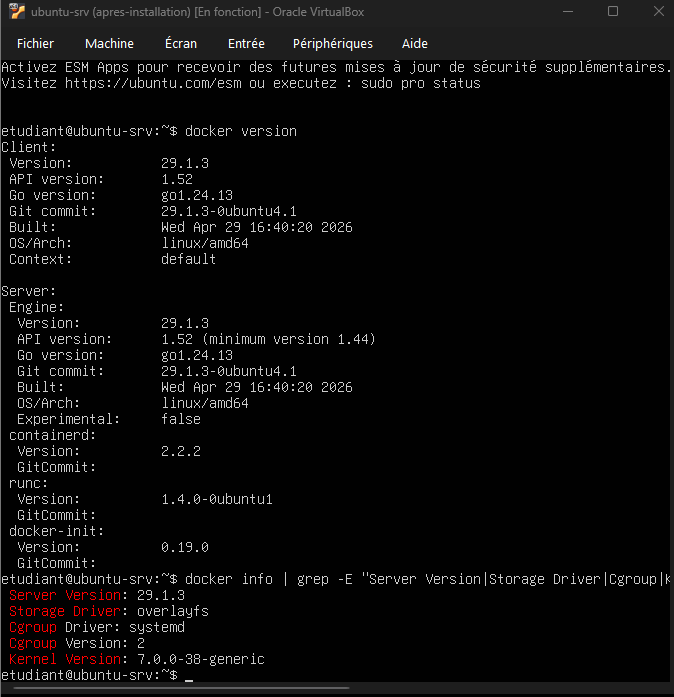](images/p0-docker-version.png)

### Réponses aux questions

**1. Version de Docker et noyau**

Docker **29.1.3** est installé (client et serveur, API 1.52). Il utilise le noyau de la VM : **7.0.0-38-generic**.

**2. Le groupe docker**

Un membre du groupe `docker` peut lancer un conteneur en root qui monte n'importe quel dossier de la VM, par exemple `docker run -v /:/hote ...`. Il peut alors lire et modifier tous les fichiers de la machine (même `/etc/shadow`), ce qui revient presque à être administrateur. Sur un serveur partagé, il faut donner ce groupe seulement à des personnes de confiance, ou utiliser Docker « rootless » ou Podman.

## Partie 1 : Lancer et inspecter des conteneurs

### Commandes lancées et sorties

```bash
docker run hello-world
docker images
docker ps -a
docker run -d --name web -p 8080:80 nginx
curl -s http://localhost:8080
docker logs --tail 5 web
docker top web
ps aux | grep "nginx: master" | grep -v grep
docker stats --no-stream web
docker exec web cat /etc/os-release | head -n 2
docker exec web uname -r
```

Résultats principaux :

- `hello-world` télécharge l'image, affiche un message de bienvenue, puis le conteneur s'arrête (statut `Exited`).
- Le conteneur `web` (image `nginx`) répond sur `http://127.0.0.1:8080` depuis le navigateur de Windows.
- `ps aux` sur la VM montre `root 2902 ... nginx: master process nginx -g daemon off;`, et `docker top web` affiche le même processus (PID 2902).
- `docker stats` : le conteneur `web` utilise **2,73 MiB** de mémoire.
- Dans le conteneur : `Debian GNU/Linux 13 (trixie)` et noyau `7.0.0-38-generic`. Sur la VM : `Ubuntu 26.04.1 LTS` et le même noyau.

[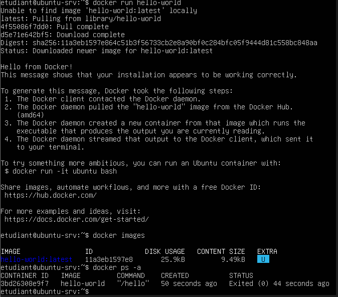](images/p1-hello-world.png)

[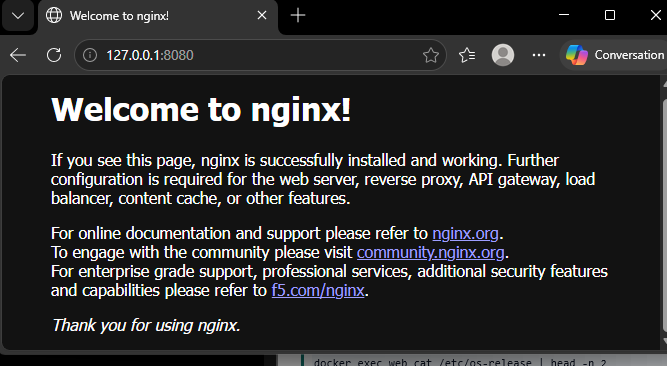](images/p1-nginx-navigateur.png)

[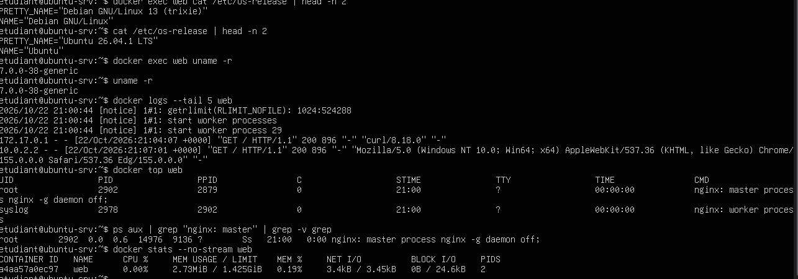](images/p1-inspection.png)

Nous avons ensuite modifié la page dans le conteneur, supprimé le conteneur, puis recréé un conteneur avec un volume :

```bash
docker exec web sh -c 'echo "<h1>Groupe POKOU - KOIKAN - N&#39;DRI</h1>" > /usr/share/nginx/html/index.html'
curl -s http://localhost:8080
docker rm -f web
docker run -d --name web -p 8080:80 nginx
curl -s http://localhost:8080 | grep -o "<title>.*</title>"
mkdir -p ~/site
echo "<h1>Groupe POKOU - KOIKAN - N'DRI : servi depuis un volume</h1>" > ~/site/index.html
docker rm -f web
docker run -d --name web -p 8080:80 -v ~/site:/usr/share/nginx/html:ro nginx
curl -s http://localhost:8080
```

Résultats : après `docker rm`, la page redevient la page par défaut (`<title>Welcome to nginx!</title>`). Avec le volume, `curl` affiche notre page « servi depuis un volume ».

[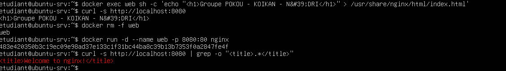](images/p1-ephemere.png)

[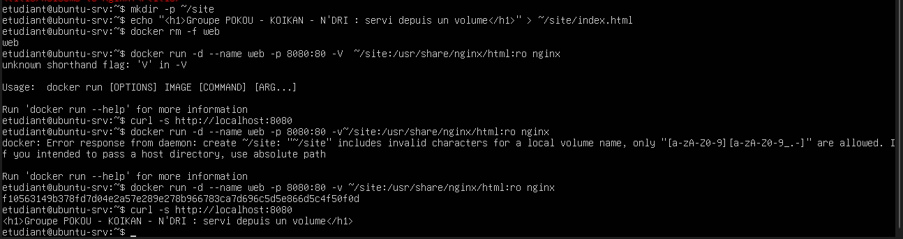](images/p1-volume.png)

[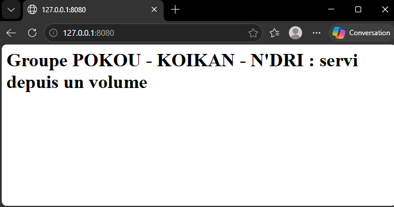](images/p1-volume-navigateur.png)

### Réponses aux questions

**1. Les quatre étapes de hello-world**

D'après le message : (1) le client Docker contacte le démon Docker ; (2) le démon télécharge l'image depuis Docker Hub ; (3) il crée un conteneur à partir de cette image et lance le programme qu'elle contient ; (4) le démon envoie la sortie de ce programme au client, qui l'affiche dans le terminal.

**2. Même distribution et même noyau ?**

La distribution est différente : le conteneur `nginx` est sous Debian 13 (trixie), alors que la VM est sous Ubuntu 26.04.1. Le noyau est le même : 7.0.0-38-generic des deux côtés. Un conteneur embarque seulement les fichiers et les bibliothèques de sa distribution, mais il utilise le noyau de l'hôte. Une VM démarre son propre noyau.

**3. Les processus Nginx dans ps aux**

Oui, les processus Nginx du conteneur apparaissent dans `ps aux` sur la VM (processus maître PID 2902). Un conteneur est donc un simple processus de l'hôte, isolé par les namespaces et limité par les cgroups, et pas une machine entière.

**4. Chemin d'une requête**

Navigateur de Windows (`127.0.0.1:8080`), puis la redirection de VirtualBox (port 8080 de l'hôte vers port 8080 de la VM), puis la redirection de Docker (`-p 8080:80` : port 8080 de la VM vers port 80 du conteneur), et enfin Nginx.

**5. Page disparue et option -v**

La page modifiée avec `docker exec` était dans la couche modifiable du conteneur, qui disparaît avec `docker rm`. Avec `-v ~/site:/usr/share/nginx/html:ro`, le dossier `~/site` de la VM est monté dans le conteneur : les fichiers sont stockés dans la VM, en dehors du conteneur, donc ils restent après sa suppression.

## Partie 2 : Comparer conteneur et VM

### Commandes lancées et sorties

```bash
docker pull alpine
docker images
time docker run --rm alpine echo "Bonjour depuis un conteneur"
time docker run --rm alpine echo "Bonjour depuis un conteneur"
systemd-analyze
free -h
docker run --rm alpine cat /etc/os-release
```

Mesures relevées :

- `docker images` : `alpine` 13 MB (3,94 MB de contenu), `nginx` 243 MB (66,8 MB de contenu), `hello-world` 25,9 kB.
- Premier `time` : `real 0m10,109s`. Deuxième `time` : `real 0m3,234s`.
- `systemd-analyze` : `Startup finished in 5.372s (kernel) + 14.793s (initrd) + 46.756s (userspace) = 1min 6.921s`.
- `free -h` : 1,4 Gi au total, 445 Mi utilisés.
- Alpine : `Alpine Linux v3.24`.

[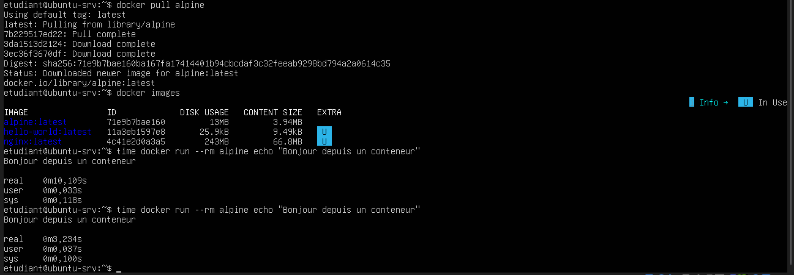](images/p2-comparaison.png)

[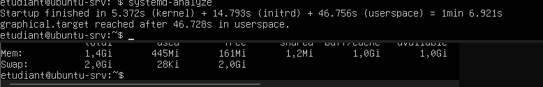](images/p2-systemd-free.png)

### Tableau de comparaison

| Mesure | VM ubuntu-srv | Conteneur nginx | Conteneur alpine |
| --- | --- | --- | --- |
| Taille sur disque | 6,66 Go (fichier disque de la VM) | 243 Mo | 13 Mo |
| Temps de démarrage | 1 min 6,9 s | | 3,2 s (2e mesure) |
| Mémoire utilisée | 445 Mi | 2,73 MiB | |
| Système | Ubuntu 26.04.1, noyau 7.0.0-38 | Debian 13 (trixie) | Alpine Linux v3.24 |

### Réponses aux questions

**1. Rapport entre la VM et les conteneurs**

| Mesure | VM | Conteneur | Rapport |
| --- | --- | --- | --- |
| Taille | 6,66 Go | 243 Mo (nginx) ou 13 Mo (alpine) | environ ×28 ou ×500 |
| Mémoire | 445 Mi | 2,73 MiB | environ ×160 |
| Démarrage | 66,9 s | 3,2 s (alpine) | environ ×20 |

Le conteneur est beaucoup plus léger (taille et mémoire, de l'ordre de ×100 ou plus) et plus rapide à démarrer (environ ×20). Nos mesures confirment donc le tableau du cours pour la taille et la mémoire. Pour le démarrage, le rapport est plus petit que prévu, parce que notre VM n'a qu'un processeur et un disque virtuel : une partie des 3,2 s sert à réveiller `containerd` et `runc`.

**2. Premier time plus long que le second**

La première exécution a pris 10,1 s et la deuxième 3,2 s. L'image était déjà téléchargée, donc ce n'est pas le réseau. La première fois, le système lit les fichiers de l'image sur le disque (cache vide) et prépare le conteneur. La deuxième fois, tout est déjà en cache mémoire, donc c'est plus rapide.

**3. Cas où une VM est préférable**

On choisit une VM quand il faut un autre noyau ou un autre système (par exemple Windows sur un hôte Linux), quand il faut une isolation forte entre des clients qui ne se font pas confiance (un conteneur partage le noyau de l'hôte), ou pour une application ancienne qui attend une machine complète.

## Partie 3 : Conteneuriser l'API fil rouge

### Commandes lancées et sorties

Le dossier `~/api` contient `app.py` (API Flask avec les routes `/`, `/sante` et `/version`), `requirements.txt` (`flask>=3,<4`), le `Dockerfile` (base `python:3.12-slim`) et `.dockerignore`. Nous avons appelé le champ du nom du groupe `groupe` (variable d'environnement `GROUPE`) à la place de `binome`.

```bash
cd ~/api
docker build -t api:1.0 .
docker images api
docker history api:1.0
docker run -d --name api -p 5000:5000 -e GROUPE="POKOU-KOIKAN-N'DRI" api:1.0
curl -s http://localhost:5000
curl -s http://localhost:5000/sante
```

Résultats :

- Le build de `api:1.0` a duré **163 s** (dont 44,6 s pour `pip install`). L'image fait **198 MB** sur disque (48,3 MB de contenu).
- `curl` sur la racine : `{"conteneur":"89ecae6947e7","groupe":"POKOU-KOIKAN-N'DRI","message":"API fil rouge"}`.
- `curl` sur `/sante` : `{"statut":"ok"}`.

[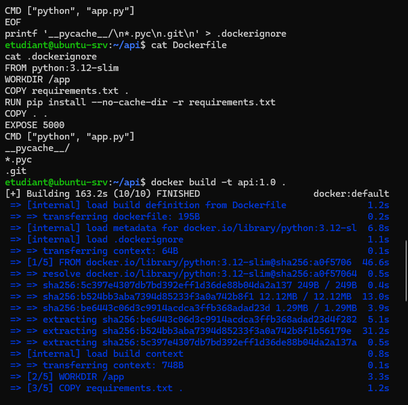](images/p3-build.png)

[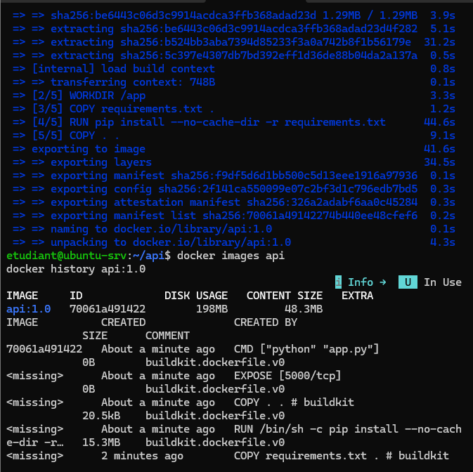](images/p3-images-api.png)

[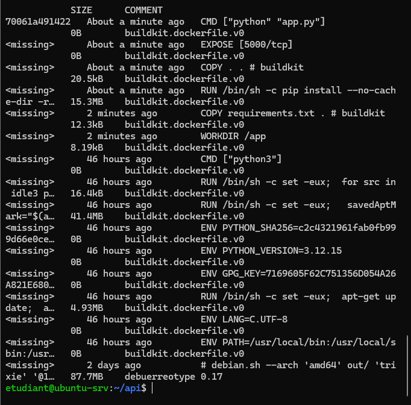](images/p3-history.png)

[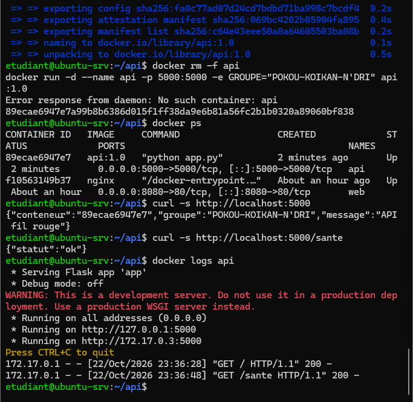](images/p3-api-curl.png)

Trois copies de la même image :

```bash
for p in 5001 5002 5003; do docker run -d --name api-$p -p $p:5000 -e GROUPE="POKOU-KOIKAN-N'DRI" api:1.0; done
for p in 5001 5002 5003; do curl -s http://localhost:$p; echo; done
docker rm -f api-5001 api-5002 api-5003
```

Les trois copies répondent avec le même `groupe` et le même `message`, mais un champ `conteneur` différent : `8a1c1a4cdbab`, `af10b5833a98` et `0c95820450a3`.

[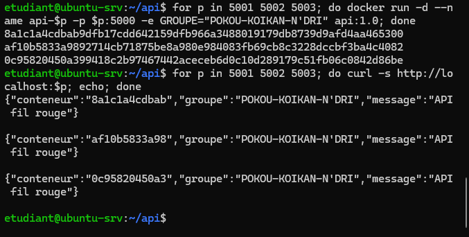](images/p3-trois-copies.png)

Nouvelle version avec la route `/version`, construite en `api:1.1` :

```bash
docker build -t api:1.1 .
docker rm -f api && docker run -d --name api -p 5000:5000 api:1.1
curl -s http://localhost:5000/version
```

Résultats : `curl` renvoie `{"version":"1.1"}`. Pour observer le cache, nous avons ensuite reconstruit `api:1.1` après une petite modification du code : le build a duré **17,4 s**.

[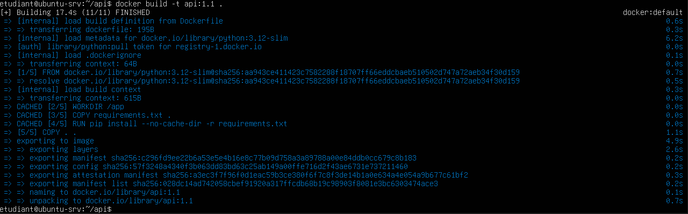](images/p3-cache.png)

### Réponses aux questions

**1. Taille, couches et Dockerfile**

L'image `api:1.0` fait **198 Mo** sur disque (48,3 Mo de contenu compressé). `docker history` affiche **16 lignes** : les 6 premières viennent de notre Dockerfile (`WORKDIR /app`, `COPY requirements.txt`, `RUN pip install`, `COPY . .`, `EXPOSE 5000`, `CMD`) et les 10 autres de l'image de base `python:3.12-slim`. La couche la plus lourde de notre Dockerfile est `RUN pip install` (15,3 Mo, c'est Flask et ses dépendances). `EXPOSE` et `CMD` font 0 octet, ce sont des métadonnées.

**2. Ordre des instructions du Dockerfile**

Le code change souvent, les dépendances rarement. Docker réutilise les couches qui n'ont pas changé (lignes `CACHED`). Le premier build a pris 163 s, avec 44,6 s pour `pip install`. Le build de `api:1.1`, après une petite modification du code, n'a pris que 17,4 s : les étapes `[2/5]`, `[3/5]` et `[4/5] RUN pip install` étaient `CACHED`, et seule `[5/5] COPY . .` a été refaite. Dans l'autre ordre, chaque changement du code relancerait `pip install`.

**3. Le champ conteneur des trois copies**

Chaque copie renvoie un identifiant différent (`8a1c1a4cdbab`, `af10b5833a98`, `0c95820450a3`) : c'est le nom d'hôte de chaque conteneur. L'expérience illustre l'**élasticité rapide** du cloud : on lance autant de copies identiques qu'on veut en quelques secondes et on les supprime aussi vite, comme le ferait un équilibreur de charge avec une mise à l'échelle automatique.

**4. Variable d'environnement**

Le nom du groupe est une configuration qui change d'un déploiement à l'autre. En le passant avec `-e`, la même image sert partout sans être reconstruite. C'est pareil pour les secrets (mots de passe, clés d'API) : il ne faut jamais les écrire dans le code ni dans l'image, parce que quelqu'un qui récupère l'image peut lire ses couches. On les donne au moment de l'exécution (variables d'environnement, gestionnaire de secrets du cloud).

## Partie 4 : Publier l'image et nettoyer

### Commandes lancées et sorties

```bash
docker login
docker tag api:1.1 evamariaan/api-fil-rouge:1.1
docker push evamariaan/api-fil-rouge:1.1
```

La connexion se fait par code d'appareil (validation sur `https://login.docker.com/activate`) : `Login Succeeded`. Le `push` envoie les couches, et se termine par le digest `sha256:9206c84ab28aa697182d21a9ed07e5a75c70ce35233dbb626178b8eebbee6f3a`.

[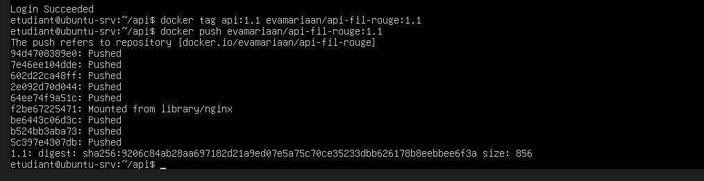](images/p4-push.png)

Vérification depuis le registre :

```bash
docker rm -f api
docker rmi evamariaan/api-fil-rouge:1.1 api:1.1
docker run -d --name api -p 5000:5000 evamariaan/api-fil-rouge:1.1
curl -s http://localhost:5000/version
```

Après la suppression des copies locales, `docker run` affiche `Unable to find image ... locally`, télécharge l'image depuis Docker Hub, et `curl` renvoie `{"version":"1.1"}`.

[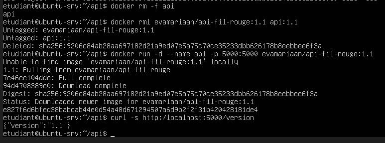](images/p4-pull-registre.png)

Nettoyage :

```bash
docker rm -f $(docker ps -aq)
docker system df
docker image prune -a -f
docker system df
docker logout
```

Résultats : `docker image prune -a -f` affiche `Total reclaimed space: 40.92MB`. Avant le nettoyage, `docker system df` indique 5 images (352,2 MB) et 110,3 MB de cache de build. Après, la ligne « Images » indique 0 image mais 149,7 MB encore signalés comme récupérables, et le cache de build reste à 110,3 MB (la commande `image prune` ne le supprime pas).

[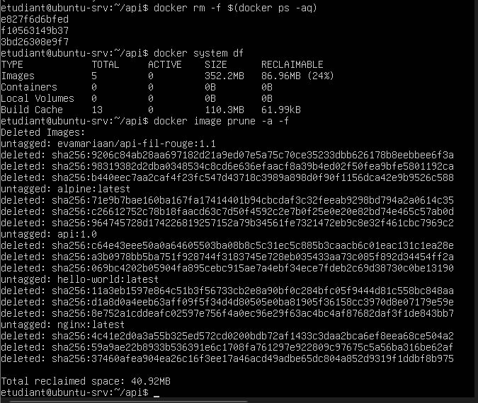](images/p4-prune.png)

[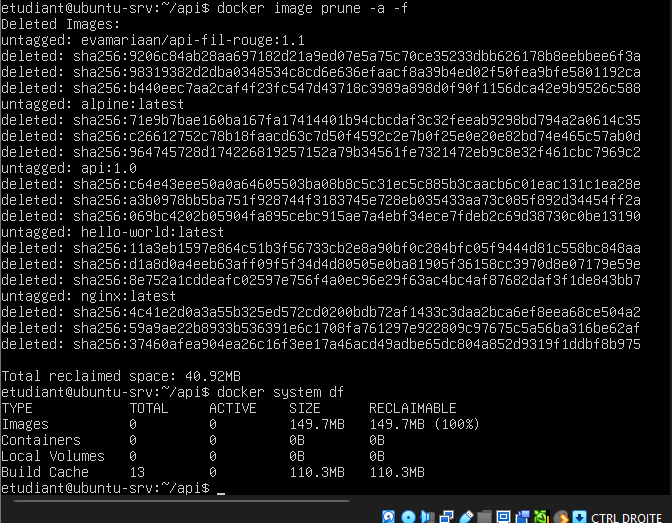](images/p4-df-apres.png)

### Réponses aux questions

**1. Adresse de l'image publiée**

L'adresse complète est `docker.io/evamariaan/api-fil-rouge:1.1` (page : `https://hub.docker.com/r/evamariaan/api-fil-rouge`). Elle est <!-- À COMPLÉTER : publique ou privée (vérifier dans les réglages du dépôt sur Docker Hub ; un nouveau dépôt est public par défaut) -->. L'image ne contient aucun secret.

[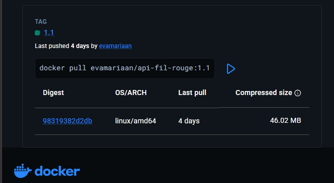](images/p4-docker-hub.png)

**2. Numéro de version et latest**

Un numéro de version (`1.1`) dit exactement ce qu'on déploie, permet de revenir à une version précédente et de reproduire un déploiement. `latest` change à chaque publication : on ne sait plus quelle version tourne, et un redéploiement peut récupérer une autre image sans qu'on le veuille.

**3. Espace libéré et registres**

`docker image prune` a libéré **40,92 Mo**. Dans le cloud, il faut aussi nettoyer les registres, parce que chaque image stockée est facturée (stockage, parfois transfert), et que de vieilles images inutilisées peuvent contenir des failles connues que quelqu'un pourrait encore déployer.

## Fichiers à joindre au dépôt

- le dossier `api/` : `app.py`, `requirements.txt`, `Dockerfile`, `.dockerignore` ;
- le lien de l'image publiée : https://hub.docker.com/r/evamariaan/api-fil-rouge ;
- ce compte rendu.

## Difficultés rencontrées

- **Apostrophe de « N'DRI »** : elle fermait trop tôt les commandes écrites entre apostrophes simples, et le terminal affichait des `>` à chaque ligne. Nous l'avons écrite `&#39;` dans la commande `docker exec`, et entre guillemets doubles dans les autres.

  [](images/p1-ephemere.png)
- **Cache du build** : la première version de `api:1.1` n'avait pas la route `/version`, parce que `app.py` n'avait pas été modifié (toutes les étapes étaient `CACHED`, même `COPY . .`). Après modification du fichier, seule la dernière étape a été refaite.
- **Alerte SSH `REMOTE HOST IDENTIFICATION HAS CHANGED`** : le port 2222 avait servi à une autre VM (`web`) du TP précédent, avec d'autres clés. Nous avons supprimé l'ancienne empreinte avec `ssh-keygen -R "[127.0.0.1]:2222"`.
- **VM figée** : la console de la VM a affiché des messages `rcu_preempt detected stalls` et `soft lockup` (le noyau a perdu du temps de processeur, sans doute à cause d'une mise en veille de Windows). La VM a continué à répondre après.

  [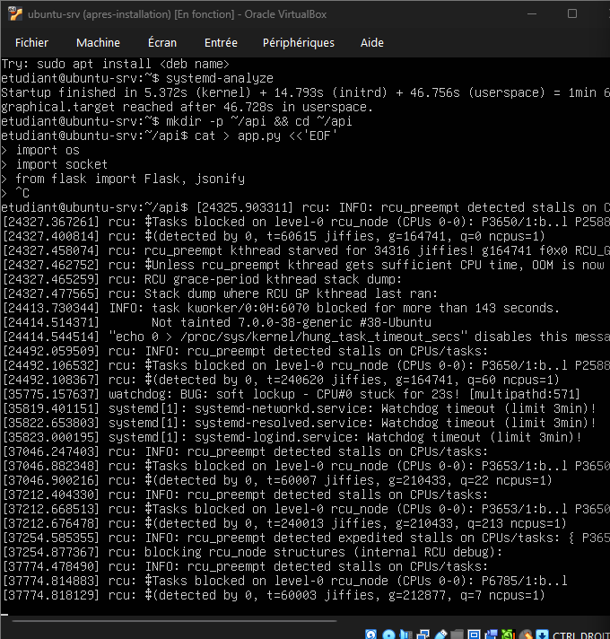](images/p5-vm-figee.png)
- **Mémoire de 4 Go** : la VM est lente, surtout pour construire l'image (163 s).
