# TP de cloud, séance 2 : Deux machines virtuelles en réseau avec VirtualBox

| | |
| --- | --- |
| **Cours** | Introduction au Cloud Computing |
| **Filière** | Licence 3 RIST / BDGL |
| **Établissement** | UFR Mathématiques & Informatique |
| **Enseignant** | BAKAYOKO Ibrahima |
| **Séance** | 2 : Modèles de service et de déploiement, responsabilité partagée |
| **Groupe** | POKOU - KOIKAN - N'DRI. Membres du groupe : POKOU EVA MARIA - KOIKAN ANGOLA CHRIST - N'DRI KOUASSI ELIOREPH |
| **Date** | Octobre 2026 |
| **Dépôt Git** | [https://github.com/evamariaan/groupe-pokou-koikan-n-dri](https://github.com/evamariaan/groupe-pokou-koikan-n-dri) |

## Objectif du TP

Dans ce TP, nous avons reproduit trois gestes d'un service IaaS : créer des machines à partir d'une image (par clonage de `ubuntu-srv`), les placer dans un sous-réseau privé (un réseau NAT VirtualBox nommé `tp-cloud`) et les protéger avec un pare-feu (`ufw`, qui joue le rôle d'un groupe de sécurité). Nous avons ensuite mesuré les ressources utilisées et tout supprimé, sauf `ubuntu-srv`.

L'énoncé demande 8 Go de RAM : notre PC n'en a que 4. Nous avons donc limité les deux VM à **1 processeur et 512 Mo** chacune, au lieu de 1 processeur et 1 Go.

### Architecture réalisée

| Machine | Adresse IP | Accès depuis l'hôte | Rôle |
| --- | --- | --- | --- |
| web | 10.10.0.10/24 | `ssh -p 2222 etudiant@127.0.0.1` | Serveur Nginx, pare-feu ufw |
| client | 10.10.0.20/24 | `ssh -p 2223 etudiant@127.0.0.1` | Poste de test (ping, curl) |
| Routeur NAT | 10.10.0.1 | aucun | Passerelle, DNS, redirections de port |
| Navigateur de l'hôte | aucune | `http://127.0.0.1:8080` | Redirigé vers web:80 |

## Sommaire

1. Partie 1 : Créer les VM par clonage
2. Partie 2 : Relier les VM en réseau
3. Partie 3 : Publier une page web et la protéger
4. Partie 4 : Mesurer et nettoyer
5. Fichiers à joindre au dépôt
6. Difficultés rencontrées

## Partie 1 : Créer les VM par clonage

### Commandes lancées et sorties

Dans PowerShell sur l'hôte, après avoir éteint `ubuntu-srv` :

```powershell
$env:Path += ";C:\Program Files\Oracle\VirtualBox"
VBoxManage controlvm ubuntu-srv acpipowerbutton
VBoxManage list runningvms
Measure-Command { VBoxManage clonevm ubuntu-srv --name web --register } | Select-Object TotalSeconds
VBoxManage clonevm ubuntu-srv --name client --register
VBoxManage modifyvm web    --cpus 1 --memory 512
VBoxManage modifyvm client --cpus 1 --memory 512
```

Sorties : `controlvm` répond que `ubuntu-srv` n'est pas en cours d'exécution (elle était déjà éteinte, l'erreur est à ignorer) et `list runningvms` est vide. `Measure-Command` donne **25,52 secondes** pour cloner `web`.

[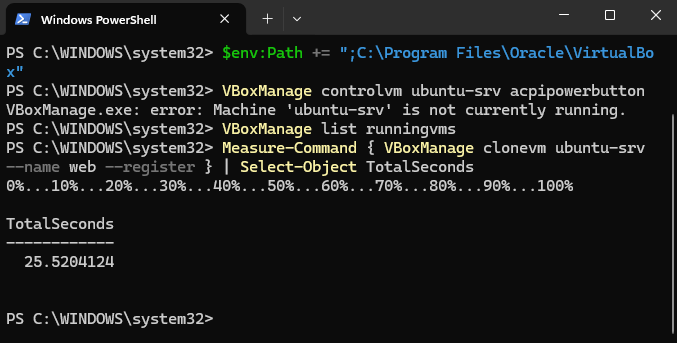](images/p1-clonage.png)

Création du réseau NAT `tp-cloud` sans DHCP, avec ses trois redirections de port :

```powershell
VBoxManage natnetwork add --netname tp-cloud --network "10.10.0.0/24" --enable --dhcp off
VBoxManage natnetwork modify --netname tp-cloud --port-forward-4 "ssh-web:tcp:[127.0.0.1]:2222:[10.10.0.10]:22"
VBoxManage natnetwork modify --netname tp-cloud --port-forward-4 "ssh-client:tcp:[127.0.0.1]:2223:[10.10.0.20]:22"
VBoxManage natnetwork modify --netname tp-cloud --port-forward-4 "http-web:tcp:[127.0.0.1]:8080:[10.10.0.10]:80"
VBoxManage natnetwork list
```

Sortie : le réseau `tp-cloud` est activé, en `10.10.0.0/24`, passerelle `10.10.0.1`, sans serveur DHCP, avec les trois redirections `ssh-web` (2222), `ssh-client` (2223) et `http-web` (8080).

[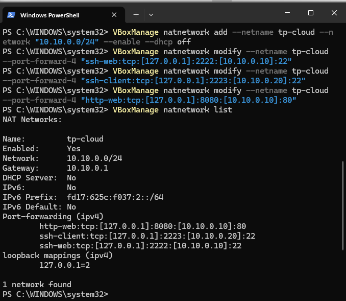](images/p1-natnetwork.png)

Branchement des deux clones sur ce réseau, puis configuration de `web` :

```powershell
VBoxManage modifyvm web    --nic1 natnetwork --nat-network1 tp-cloud
VBoxManage modifyvm client --nic1 natnetwork --nat-network1 tp-cloud
VBoxManage showvminfo web | Select-String "Memory size|Number of CPUs|NIC 1"
```

Sortie : `web` a **512 Mo**, **1 CPU**, et sa carte réseau 1 est sur `NAT Network 'tp-cloud'`.

[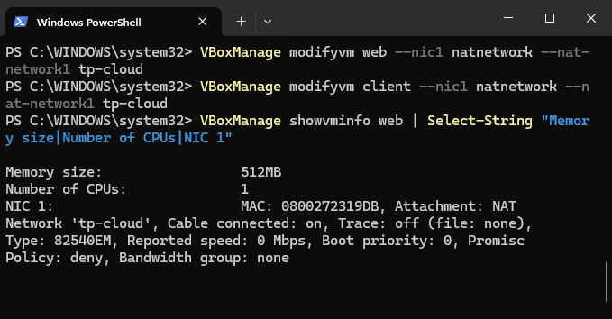](images/p1-showvminfo.png)

Chaque clone est ensuite personnalisé dans sa console. Pour `web` :

```bash
sudo hostnamectl set-hostname web
sudo sed -i 's/ubuntu-srv/web/g' /etc/hosts
sudo rm -f /etc/machine-id && sudo systemd-machine-id-setup
sudo rm -f /etc/ssh/ssh_host_* && sudo ssh-keygen -A
```

Puis, toujours sur la console de `web`, l'adresse fixe `10.10.0.10` pour `enp0s3` (pour `client`, on remplace `web` par `client` et l'adresse par `10.10.0.20/24`) :

```bash
sudo tee /etc/netplan/99-tp.yaml > /dev/null <<'EOF'
network:
  version: 2
  ethernets:
    enp0s3:
      dhcp4: false
      addresses: [10.10.0.10/24]
      routes:
        - to: default
          via: 10.10.0.1
      nameservers:
        addresses: [10.10.0.1, 1.1.1.1]
EOF
sudo chmod 600 /etc/netplan/99-tp.yaml
sudo netplan apply
ip -4 addr show enp0s3
sudo reboot
```

Sortie sur `web` : `inet 10.10.0.10/24` sur `enp0s3`, `default via 10.10.0.1`, et le ping vers 10.10.0.1 répond (2 reçus sur 2, 0 % de perte, moyenne 3,491 ms).

[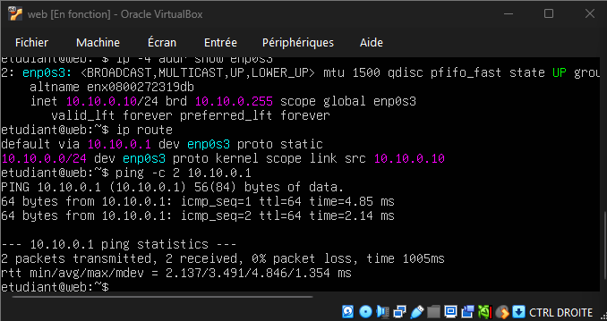](images/p1-ip-web.png)

Depuis l'hôte, connexion aux deux VM en SSH :

```powershell
ssh-keygen -R "[127.0.0.1]:2222"
ssh-keygen -R "[127.0.0.1]:2223"
ssh -p 2222 etudiant@127.0.0.1 "hostnamectl; lsb_release -a; uname -r"
ssh -p 2223 etudiant@127.0.0.1 "hostname; ip -4 -br addr"
```

Sortie pour `client` : le nom d'hôte est `client`, `lo` est à `127.0.0.1/8` et `enp0s3` est `UP` à `10.10.0.20/24`.

[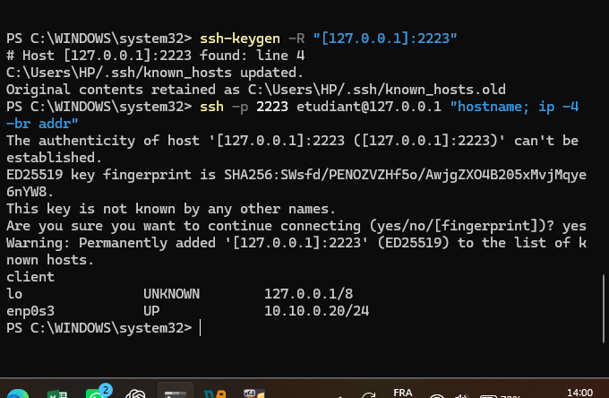](images/p1-ssh-client.png)

### Réponses aux questions

**1. Durée du clonage**

Le clonage de `web` a pris **25,5 secondes**. L'installation d'Ubuntu au TP précédent avait duré environ 20 minutes 35 secondes. Un serveur physique demande une commande, une livraison, un montage et une installation : des jours, voire des semaines. Cloner une image est donc beaucoup plus rapide, et c'est le principe du lancement d'une instance cloud.

**2. Pourquoi changer le nom, l'identifiant de machine et les clés SSH d'un clone ?**

Un clone est une copie exacte : il a le même nom d'hôte, le même `machine-id` et les mêmes clés SSH que la VM d'origine. Le nom et le `machine-id` servent à identifier la machine, donc deux machines identiques se confondent. Les clés SSH prouvent l'identité du serveur. Si 50 serveurs avaient les mêmes clés, il suffirait de voler la clé privée d'un seul pour se faire passer pour les 50 (attaque de l'homme du milieu), et les clients ne pourraient plus les distinguer. Le cloud régénère ces éléments automatiquement au premier démarrage (cloud-init).

**3. Version d'Ubuntu, noyau, vCPU et RAM de web**

`web` tourne sous **Ubuntu 26.04.1 LTS**, noyau **7.0.0-38-generic**, avec **1 vCPU** et **512 Mo** de RAM (453 Mi visibles par le système). `ubuntu-srv` joue le rôle d'une **AMI** sur AWS : c'est le modèle à partir duquel on lance des instances (sur Azure ou Google Cloud, on parle d'image).

[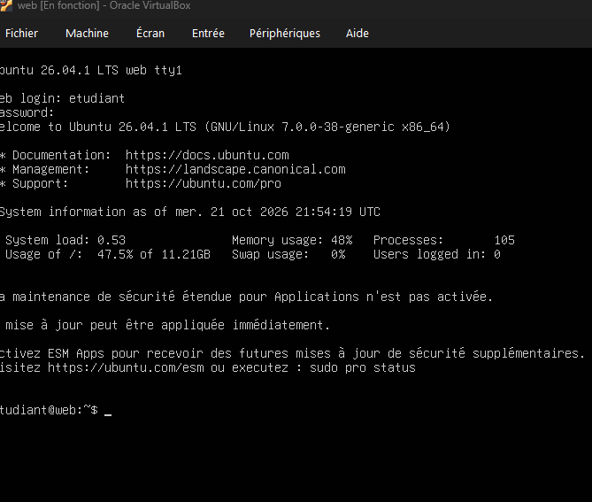](images/p1-web-systeme.png)

## Partie 2 : Relier les VM en réseau

### Commandes lancées et sorties

Depuis PowerShell sur l'hôte, connexion à `client`, puis dans `client` :

```powershell
ssh -p 2223 etudiant@127.0.0.1
```

```bash
ping -c 4 10.10.0.10
ping -c 2 10.10.0.1
ping -c 2 1.1.1.1
ip route
resolvectl status | grep "DNS Servers"
echo "10.10.0.10 web" | sudo tee -a /etc/hosts
ping -c 2 web
exit
```

Sortie : les trois pings aboutissent sans perte. Vers `web` (10.10.0.10) : 4 paquets reçus sur 4, moyenne **5,364 ms**. Vers la passerelle (10.10.0.1) : 2 sur 2, moyenne 1,662 ms. Vers Internet (1.1.1.1) : 2 sur 2, moyenne 29,390 ms.

[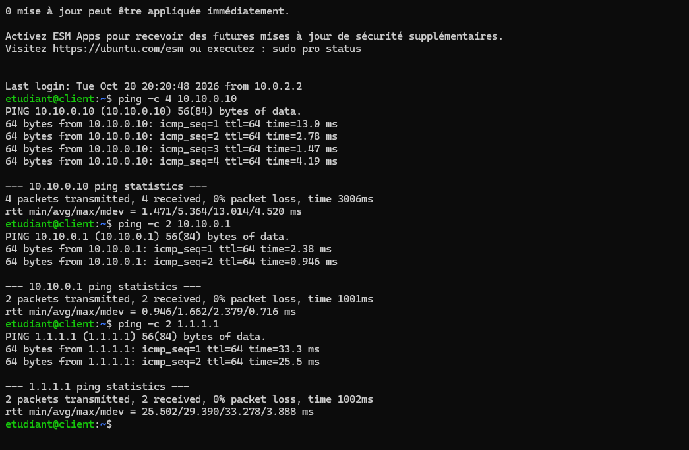](images/p2-connectivite.png)

`ip route` montre `default via 10.10.0.1 dev enp0s3` et `10.10.0.0/24 dev enp0s3 ... src 10.10.0.20`. Les serveurs DNS sont `10.10.0.1` et `1.1.1.1`. Le nom `web` ajouté dans `/etc/hosts` fonctionne : `ping -c 2 web` répond (2 sur 2, moyenne 6,117 ms) et permet ensuite d'utiliser `http://web`.

[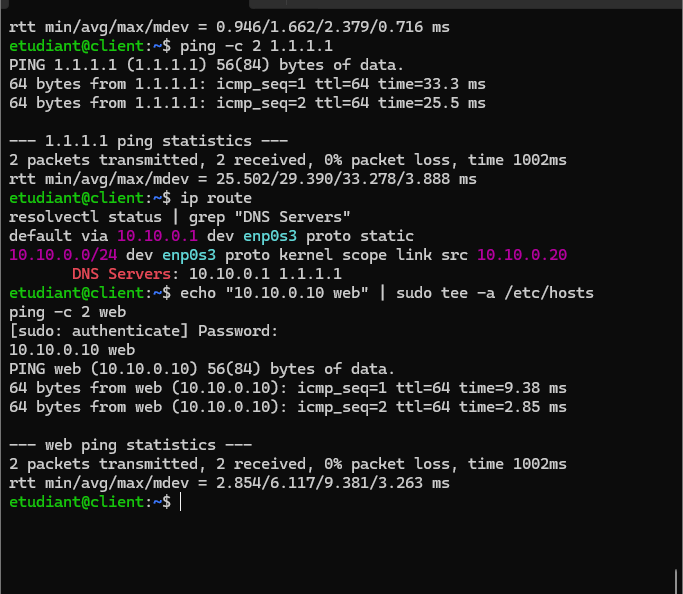](images/p2-route-dns-hosts.png)

Depuis PowerShell sur l'hôte :

```powershell
ping -n 2 10.10.0.10
```

Sortie : les deux requêtes expirent (« Délai d'attente de la demande dépassé »), soit 2 paquets envoyés, 0 reçu, **100 % de perte**. Les connexions SSH par les ports 2222 et 2223 fonctionnent pourtant.

[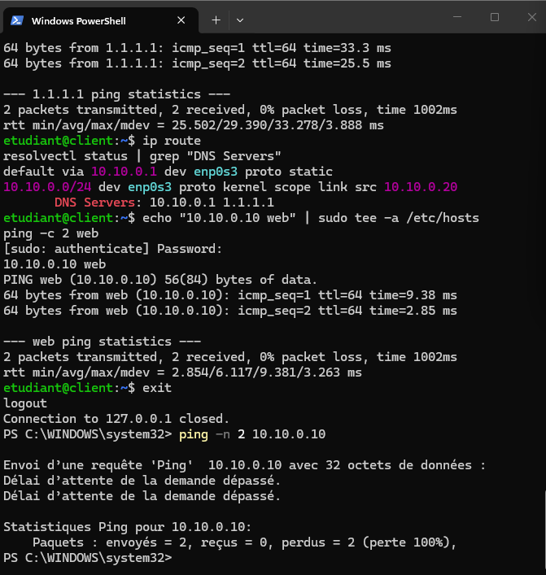](images/p2-ping-windows.png)

### Réponses aux questions

**1. Même sous-réseau ?**

Oui. `web` a l'adresse 10.10.0.10/24 et `client` 10.10.0.20/24. Le masque /24 (255.255.255.0) fixe les trois premiers octets : les deux adresses sont dans le réseau **10.10.0.0/24** et se joignent directement, sans routeur.

**2. Passerelle par défaut de client**

La passerelle est **10.10.0.1** (`default via 10.10.0.1`). Elle reçoit tout le trafic qui sort du sous-réseau et le fait aller vers Internet : c'est le routeur du réseau NAT virtuel. Elle correspond, dans un VPC d'AWS, à la table de routage avec sa route par défaut vers une passerelle Internet ou NAT (sur Azure, la route par défaut du VNet vers Internet).

**3. Temps de réponse du ping**

Le ping de `client` vers `web` donne **5,364 ms en moyenne** (minimum 1,471 ms, maximum 13,014 ms, 0 % de perte). Le premier paquet est le plus lent (13,0 ms) : la VM doit d'abord résoudre l'adresse MAC de `web` (ARP), puis les suivants passent à 1 à 4 ms. À titre de comparaison, la passerelle répond en 1,662 ms en moyenne et Internet (1.1.1.1) en 29,390 ms. Le temps vers `web` est faible parce que les deux VM sont sur la même machine physique : le trafic reste dans le réseau virtuel, sans câble ni commutateur réels, alors que le trafic vers 1.1.1.1 doit traverser le réseau de l'opérateur.

**4. Ping depuis Windows et accès en SSH**

Le ping depuis Windows vers 10.10.0.10 n'aboutit pas : l'hôte n'est pas dans ce sous-réseau privé et n'a pas de route vers lui. Le SSH fonctionne grâce à la redirection de port : 127.0.0.1:2222 sur Windows est renvoyé vers 10.10.0.10:22. Cette règle ne transporte que du TCP sur ce port, pas le ping (ICMP). Dans le cloud, c'est comme une adresse IP publique avec une règle entrante : le sous-réseau reste privé et seul le port exposé est joignable.

## Partie 3 : Publier une page web et la protéger

### Commandes lancées et sorties

Depuis PowerShell, connexion à `web`, puis dans `web` :

```powershell
ssh -p 2222 etudiant@127.0.0.1
```

```bash
sudo apt update && sudo apt install -y nginx
systemctl status nginx --no-pager
echo "<h1>Groupe POKOU - KOIKAN - N'DRI : ma première VM en réseau</h1>" | sudo tee /var/www/html/index.html
exit
```

Sortie : le paquet `nginx` est installé, le service est `active (running)` et la page contient le titre du groupe.

[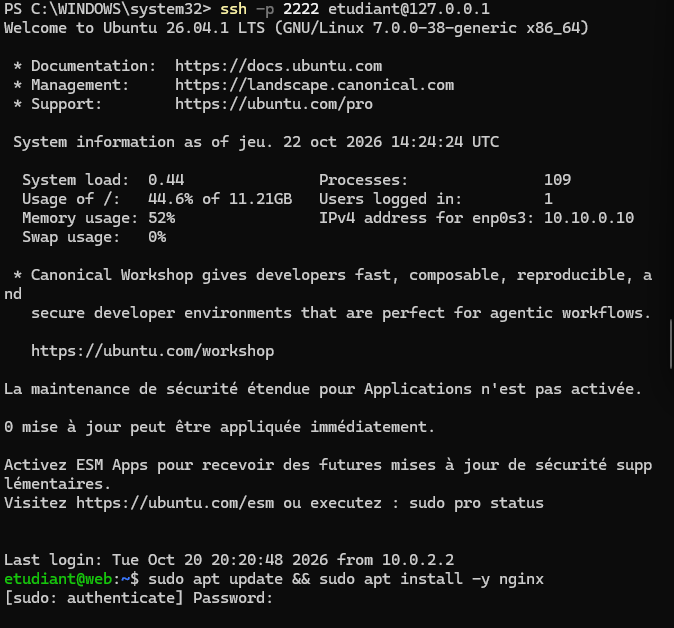](images/p3-nginx-install-debut.png)

[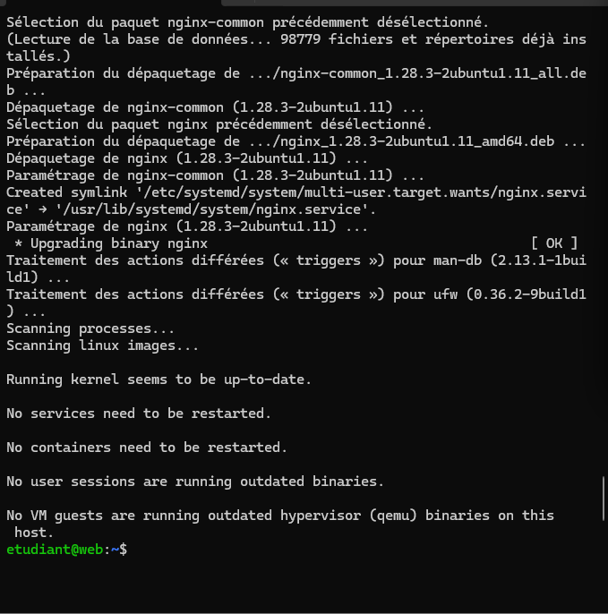](images/p3-nginx-install-fin.png)

[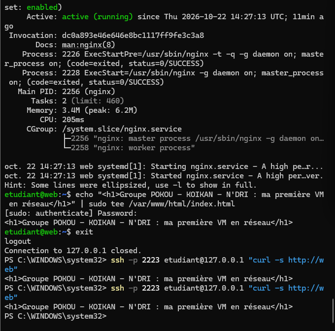](images/p3-nginx-status-curl.png)

Test depuis `client` (lancé depuis l'hôte) et depuis le navigateur :

```powershell
ssh -p 2223 etudiant@127.0.0.1 "curl -s http://web"
```

Sortie : `<h1>Groupe POKOU - KOIKAN - N'DRI : ma première VM en réseau</h1>`. La page s'affiche aussi sur `http://127.0.0.1:8080` dans le navigateur de Windows, mais les accents y sont mal rendus (voir « Difficultés rencontrées »).

[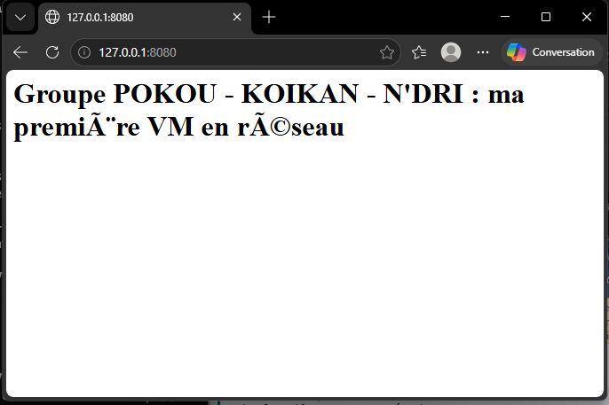](images/p3-navigateur-8080.png)

Activation du pare-feu dans `web` (OpenSSH est autorisé avant `ufw enable`, pour ne pas perdre l'accès SSH) :

```bash
sudo ufw allow OpenSSH
sudo ufw enable
sudo ufw status verbose
```

Sortie : `Status: active`, `Default: deny (incoming), allow (outgoing)`, et seule la règle `22/tcp (OpenSSH) ALLOW IN` (et sa version IPv6). Le port 80 n'y est pas.

[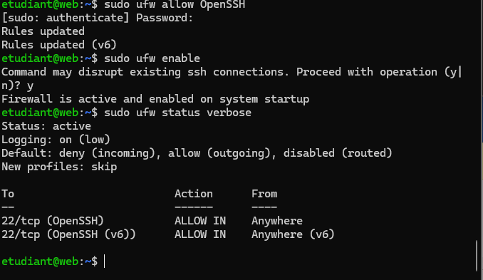](images/p3-ufw-verbose.png)

Test avec le port 80 fermé :

```powershell
ssh -p 2223 etudiant@127.0.0.1 "curl -m 5 http://web; echo code retour: `$?"
```

Sortie : `curl: (28) Connection timed out after 5001 milliseconds` et `code retour: 28`. Dans le navigateur, la page est « impossible d'accéder ».

[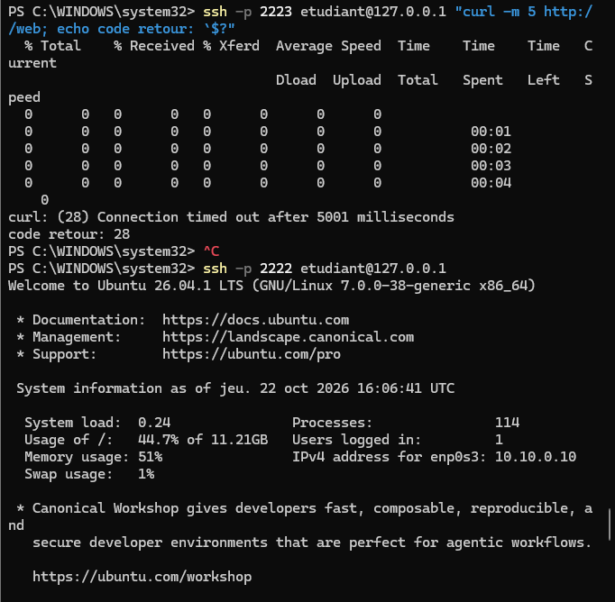](images/p3-curl-timeout.png)

Ouverture du port 80 dans `web`, puis nouveau test :

```bash
sudo ufw allow 'Nginx HTTP'
sudo ufw status numbered
sudo ss -tlnp
```

```powershell
ssh -p 2223 etudiant@127.0.0.1 "curl -s http://web"
```

Sortie : la règle `Nginx HTTP ALLOW IN` apparaît, et la page est de nouveau accessible depuis `client` et depuis le navigateur.

[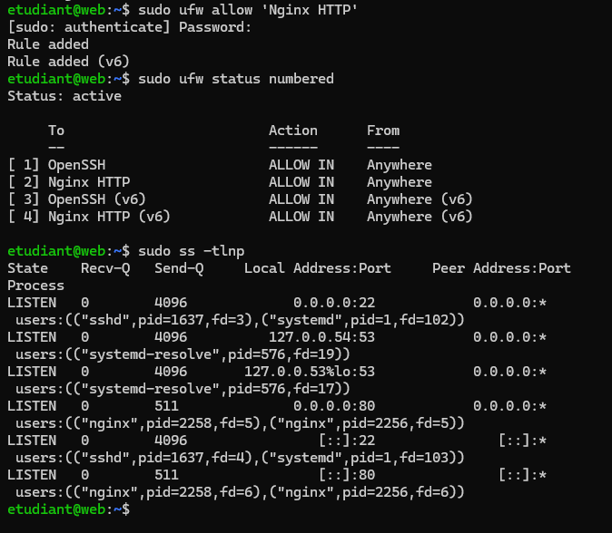](images/p3-ufw-ss.png)

[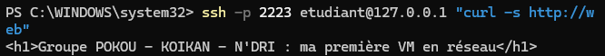](images/p3-curl-apres-ouverture.png)

### Réponses aux questions

**1. curl avec le port 80 fermé**

`curl` affiche `curl: (28) Connection timed out after 5001 milliseconds` et le code retour est **28**. Le pare-feu jette le paquet en silence (DROP) au lieu de répondre : le client attend jusqu'à la fin du délai. Si le pare-feu refusait explicitement (REJECT), on aurait tout de suite « connexion refusée ». C'est pour ça que le navigateur reste bloqué.

**2. Port et adresses de Nginx**

Nginx écoute sur le **port 80**, sur toutes les adresses : `0.0.0.0:80` (IPv4) et `[::]:80` (IPv6).

**3. ufw et groupe de sécurité**

Ressemblances : les deux filtrent le trafic par port, protocole et source, et les deux refusent tout le trafic entrant par défaut, sauf ce qu'on ouvre explicitement (ici OpenSSH puis Nginx HTTP). Différence : `ufw` tourne dans la VM, donc quelqu'un qui compromet la machine peut le désactiver, alors qu'un groupe de sécurité est appliqué à l'extérieur de l'instance, au niveau du réseau virtuel, et se gère par la console ou l'API du fournisseur.

**4. Qui gère quoi ?**

Dans un service IaaS, le client gère l'**application, les données, le runtime, le middleware et le système d'exploitation**. Dans ce TP, nous avons géré nous-mêmes : l'OS (nom d'hôte, clés SSH, adresse réseau, mises à jour), le middleware (Nginx), l'application et les données (la page web) et le pare-feu de la VM. VirtualBox a fourni la **virtualisation, les serveurs, le stockage** (le disque virtuel) et le **réseau** (le réseau NAT `tp-cloud`). Notre PC joue le rôle du matériel du fournisseur.

## Partie 4 : Mesurer et nettoyer

### Commandes lancées et sorties

Depuis PowerShell, mesures vues de l'intérieur de `web` :

```powershell
ssh -p 2222 etudiant@127.0.0.1 "free -h; df -h /; nproc"
```

Sortie : `free -h` indique 453 Mi au total, 220 Mi utilisés et 223 Mi en cache. `df -h /` indique 12 G, 5,1 G utilisés (48 %). `nproc` indique 1.

[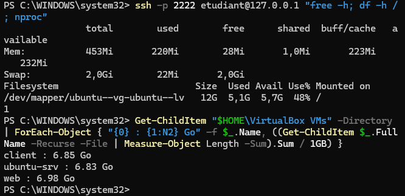](images/p4-mesures-tailles.png)

Sur l'hôte, nous avons regardé les processus `VirtualBoxVM.exe` dans le Gestionnaire des tâches (onglet Détails), puis la taille des dossiers des VM :

```powershell
Get-ChildItem "$HOME\VirtualBox VMs" -Directory | ForEach-Object { "{0} : {1:N2} Go" -f $_.Name, ((Get-ChildItem $_.FullName -Recurse -File | Measure-Object Length -Sum).Sum / 1GB) }
```

Sortie (visible sur la capture ci-dessus) :

```
client : 6.85 Go
ubuntu-srv : 6.83 Go
web : 6.98 Go
```

Arrêt et suppression de tout ce qui a été créé pour le TP :

```powershell
VBoxManage controlvm web acpipowerbutton
VBoxManage controlvm client acpipowerbutton
VBoxManage list runningvms
VBoxManage startvm web --type headless
VBoxManage controlvm web poweroff
VBoxManage unregistervm web --delete
VBoxManage unregistervm client --delete
VBoxManage natnetwork remove --netname tp-cloud
VBoxManage list vms
```

Sortie : seule `ubuntu-srv` reste dans la liste (elle est conservée pour les TP suivants).

[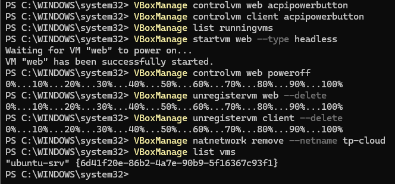](images/p4-nettoyage.png)

### Réponses aux questions

**1. RAM vue par la VM et RAM consommée sur l'hôte**

La VM `web` voit **453 Mi** de RAM (512 Mo configurés), dont 220 Mi utilisés. Sur l'hôte, les processus `VirtualBoxVM.exe` du Gestionnaire des tâches montrent seulement de l'ordre de **40 à 70 Mo** chacun (41 512 Ko et 71 064 Ko sur la capture ci-dessous, les autres processus étant à 8 Ko).

[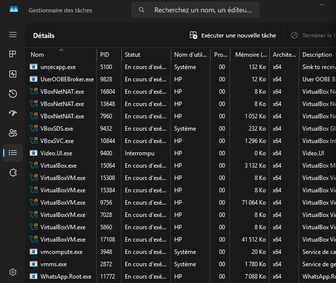](images/p4-gestionnaire-taches.png)

L'écart vient du fait que VirtualBox ne prend la mémoire à Windows que lorsque la VM la touche, et que cette colonne ne compte que les pages présentes en RAM à ce moment-là. La consommation réelle est donc plus proche de la RAM utilisée par la VM, plus un surcoût de VirtualBox.

**2. Place du disque d'un clone sur l'hôte**

Le disque fait 25 Go pour la VM, mais le dossier de `web` pèse seulement **6,98 Go** sur l'hôte (6,85 Go pour `client`, 6,83 Go pour `ubuntu-srv`). Le disque VDI est alloué dynamiquement : le fichier ne grossit qu'avec les données réellement écrites. Le clone est une copie des données utilisées, d'où une taille proche de celle de l'original.

**3. acpipowerbutton, poweroff et unregistervm --delete**

`acpipowerbutton` envoie un signal d'arrêt à l'OS, qui s'éteint proprement. `poweroff` coupe la VM brutalement, comme si on débranchait la prise : il y a un risque de corruption. `unregistervm --delete` supprime la VM de VirtualBox et efface ses fichiers, dont le disque, de façon définitive (c'est l'équivalent du *terminate* d'une instance cloud).

**4. VM arrêtée et facturation**

Dans le cloud, le calcul (vCPU et RAM) n'est en général plus facturé quand la VM est arrêtée. Mais son **disque** reste facturé tant qu'il existe, ainsi que l'**adresse IP publique réservée** et les instantanés. Pour ne plus rien payer, il faut supprimer l'instance et toutes ses ressources associées.

## Fichiers à joindre au dépôt

- ce compte rendu `Tp2 reseau.md` ;
- le dossier `images/` avec les captures.

## Difficultés rencontrées

- **Mémoire de 4 Go** : le Gestionnaire des tâches indique 87 % de mémoire utilisée (3,3 Go sur 3,8 Go, 508 Mo disponibles). L'énoncé demande 8 Go de RAM : nous avons donc limité les deux VM à 512 Mo et fermé les autres applications pendant les tests.

  [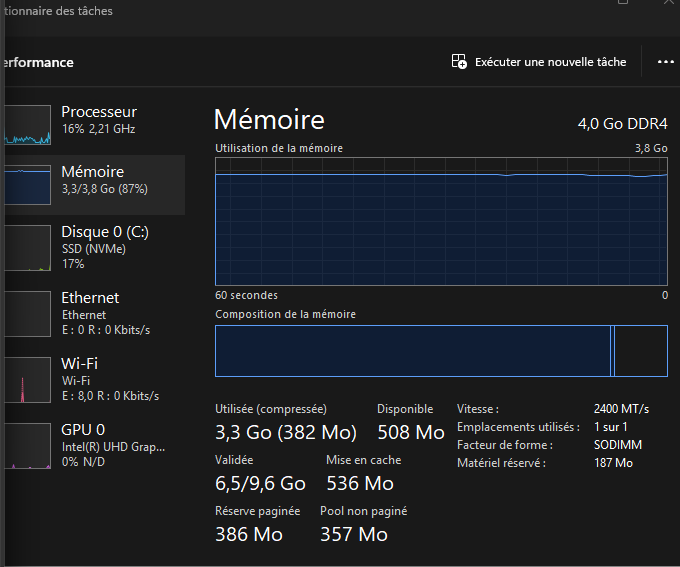](images/difficulte-memoire.png)

- **Accents mal affichés dans le navigateur** : sur `http://127.0.0.1:8080`, le titre apparaît « première VM en réseau ». Le fichier `index.html` ne déclare pas son encodage, donc le navigateur ne devine pas l'UTF-8, alors que `curl` dans le terminal affiche correctement le texte. La solution est d'ajouter `<meta charset="utf-8">` au début de la page.

  [](images/p3-navigateur-8080.png)
